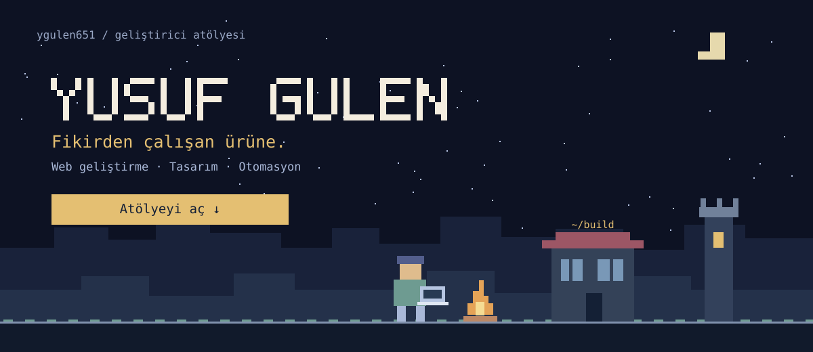
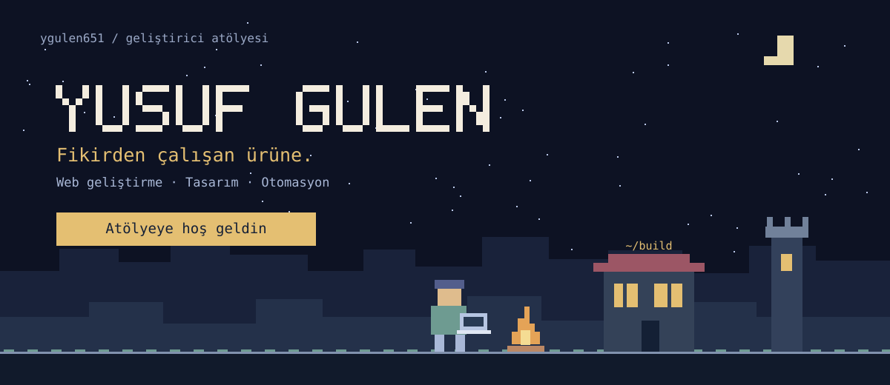
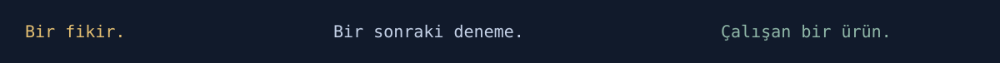

### Atölyeye hoş geldin

Web siteleri, uygulamalar ve otomasyonlar geliştiriyorum. Tasarımla kodun buluştuğu yerde çalışmayı seviyorum.

[Projelerimi keşfet](https://github.com/ygulen651?tab=repositories) · [Birlikte çalışalım](mailto:ygulen651@gmail.com)

<b>Merhaba, ben Yusuf Gülen.</b> Web geliştirme, tasarım ve otomasyonla fikirleri çalışan ürünlere dönüştürüyorum.

## Hakkımda

- Ahi Evran Üniversitesi Web Tasarımı ve Kodlama mezunuyum.
- Next.js ve WordPress ile web projeleri geliştiriyorum.
- n8n ile iş akışlarını otomatikleştirmeye ilgi duyuyorum.
- Arayüzden arka uca, bir ürünün bütününü kurmayı seviyorum.

## Projelerim

| Proje | Neler var? |
| :--- | :--- |
| **[Ugi Ajans](https://github.com/ygulen651/ugi-net-)** | Türkçe ve İngilizce içerik, tema seçimi ve etkileşimli bölümler içeren yaratıcı ajans sitesi. |
| **[Detay Sigorta](https://github.com/ygulen651/detay-sigorta)** | Next.js ile geliştirilen, içerik yönetim paneli bulunan kurumsal web sitesi. |
| **[Kelime Avcısı](https://github.com/ygulen651/kelimeav-c-s-weble)** | Kelime Avcısı uygulaması için hazırladığım statik tanıtım sitesi. |

[Diğer projelerime göz at](https://github.com/ygulen651?tab=repositories)

## Araç çantam

**Diller:** JavaScript · Python  
**Web:** Next.js · Node.js · WordPress  
**Otomasyon ve araçlar:** n8n · Git · Linux

## İletişim

[LinkedIn](https://www.linkedin.com/in/yusuf-g%C3%BClen-01455b1a9/) · [E-posta](mailto:ygulen651@gmail.com)
