**Atölyeye hoş geldin.** Web siteleri, uygulamalar ve otomasyonlar geliştiriyorum.

[Projelerimi keşfet](https://github.com/ygulen651?tab=repositories) · [Birlikte çalışalım](mailto:ygulen651@gmail.com)

## Merhaba, ben Yusuf.

Ahi Evran Üniversitesi **Web Tasarımı ve Kodlama** mezunuyum. Next.js ve WordPress ile web projeleri geliştiriyor, **n8n** ile iş akışlarını otomatikleştirmeyi keşfediyorum. Tasarımla kodun buluştuğu yerde çalışmayı seviyorum.

## Projelerim

**[Ugi Ajans](https://github.com/ygulen651/ugi-net-)** — Türkçe ve İngilizce içerik, tema seçimi ve etkileşimli bölümler.

**[Detay Sigorta](https://github.com/ygulen651/detay-sigorta)** — Next.js ile geliştirilen, içerik yönetim paneli bulunan kurumsal web sitesi.

**[Kelime Avcısı](https://github.com/ygulen651/kelimeav-c-s-weble)** — Kelime Avcısı uygulaması için statik tanıtım sitesi.

[Diğer projelerime göz at](https://github.com/ygulen651?tab=repositories)

## Kullandığım teknolojiler

**JavaScript · Python · Next.js · Node.js · WordPress · n8n · Git · Linux**

## İletişim

[E-posta](mailto:ygulen651@gmail.com) · [LinkedIn](https://www.linkedin.com/in/yusuf-g%C3%BClen-01455b1a9/)

